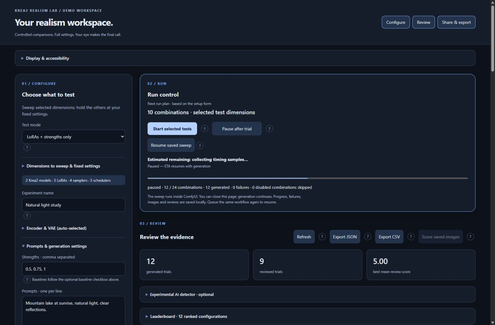
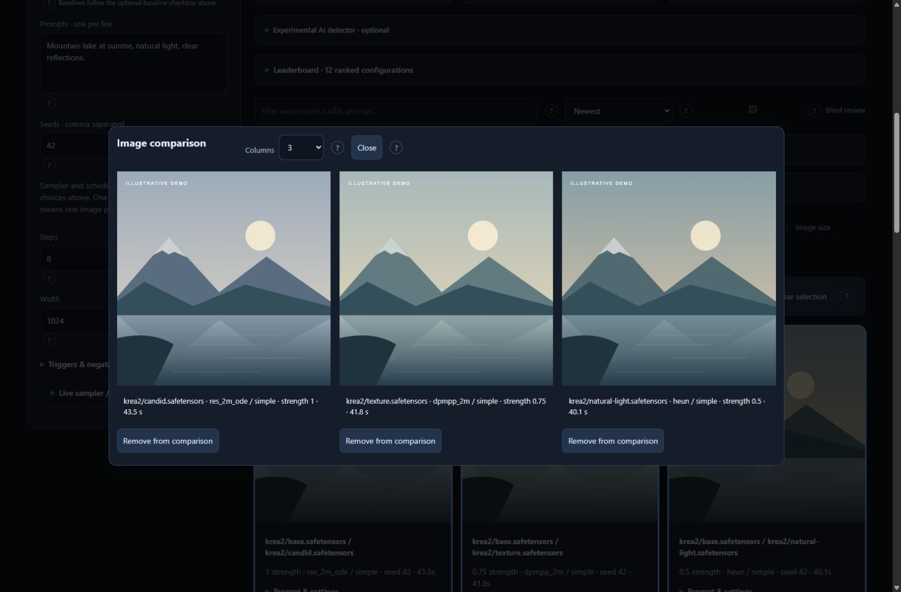
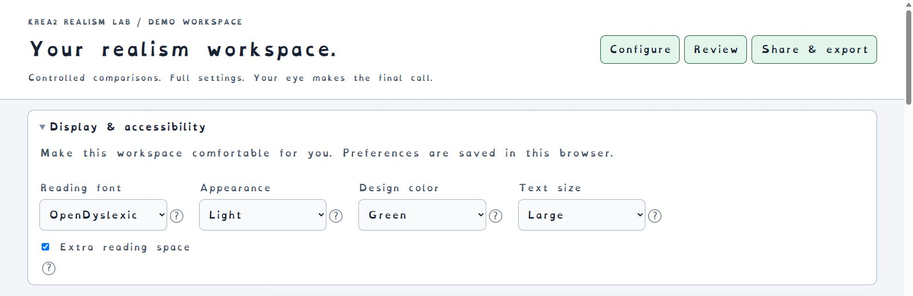

# Krea2 Realism Lab

**Find the Krea2 settings you like best—from a local webpage.**

Automatically compare models, LoRAs, strengths, samplers and schedulers. Review the images, compare results and share a complete voting website. No workflow editing or manually placing nodes required.

[Download for Windows](https://github.com/ThuGie/Krea2-Realism-Lab/releases/latest) · [User guide](docs/usage.md) · [Troubleshooting](docs/advanced.md#troubleshooting)

## Start in a few clicks

1. **Download and extract** the [latest release ZIP](https://github.com/ThuGie/Krea2-Realism-Lab/releases/latest). Keep its files together.
2. **Double-click `Start-Krea2-Lab.bat`.**
3. **Choose your ComfyUI folder.** The launcher remembers it for next time.
4. **Choose a test mode**, check the number of combinations and click **Start selected tests**.

The launcher installs the extension, starts or connects to ComfyUI, and opens the webpage. You do not need a separate Python or Node.js installation.

**You need:** Windows 10/11, a working ComfyUI installation with Krea2 support, your models and compatible encoder/VAE, and enough GPU memory to run them. Models are not included or downloaded automatically.

> **Start small:** choose **LoRAs + strengths only** for your first comparison. **Everything** is the initial default and can produce a very large number of images.

## Choose what to compare

| Want to test… | Choose this mode |
|---|---|
| All your LoRAs at different strengths | LoRAs + strengths only |
| One LoRA at different strengths | Strengths of one LoRA |
| Samplers, schedulers, or both | Samplers only / Schedulers only / Samplers + schedulers |
| Your Krea2 models | Models only |
| All main dimensions together | Everything |
| Your own combination, including step or CFG grids | Custom combination |

The app discovers files whose name or folder contains `krea`. For reliable discovery, put models in `models/diffusion_models/krea2/` and LoRAs in `models/loras/krea2/`.

Each selected combination runs once per prompt and seed. LoRAs are tested individually. Use the **?** buttons for explanations beside every option.

## Review at your own pace

- Rate realism from **1–5** and keep private notes.
- Compare **2–8 images** together, choose the columns and zoom into details. With exactly two images, use the **A/B slider** to drag between overlapping views.
- Sort by rating or **generation speed**; filter by experiment or unreviewed images.
- Use blind review to hide generation labels.
- Disable incompatible sampler/scheduler pairs while a run continues; import or export your exclusion list.
- Export results as **JSON or CSV**.

## Make it comfortable

Open **Display & accessibility** near the top of the page. Choose OpenDyslexic, larger text, extra reading space, six accent colors, or a light, dark or high-contrast appearance. Your choices are saved in your browser.

*Screenshots show the real interface with synthetic demo records and illustrative thumbnails—not generation-quality examples. No private runs or images are included.*

## Pause, resume and keep your work

**Pause after trial** finishes the current image and saves progress. **Resume saved sweep** continues the saved plan. Closing the webpage does not stop generation.

Images, reviews and checkpoints are saved in your ComfyUI output folder under **`krea2_lab/`**. Back up that folder to keep your work.

To stop a backend started by the launcher, use **`Stop-Krea2-Lab.bat`**. It stops generation too. The launcher will not restart a busy backend when installing updates; pause and let the current image finish first.

## Let other people vote

Open **Export a standalone voting website**, select a run and click **Build voting website ZIP**.

The ZIP includes **HTML, JavaScript, CSS, PHP, images and SQLite**, plus a voting gallery, leaderboards and an admin page. It runs independently of ComfyUI.

Hosting needs **PHP 8.1+ with PDO_SQLITE**. Serve only the `public/` folder; keep `private/` and the admin key outside the web root. Follow the included `HOSTING.md`, or read the [hosting guide](docs/hosting.md).

## Need help?

| Problem | First thing to try |
|---|---|
| No models or LoRAs found | Check the `krea2` folders and ComfyUI's model paths. |
| ComfyUI is busy during an update | Pause the sweep and wait for the current image to finish. |
| A sampler/scheduler pair fails | Disable that pair; the other tests can continue. |
| Want to repeat completed tests | Give the experiment a new name. |
| Startup fails | Check the logs in `%LOCALAPPDATA%\Krea2RealismLab`. |

[Full user guide](docs/usage.md) · [Hosting guide](docs/hosting.md) · [Advanced setup, troubleshooting and development](docs/advanced.md)

The experimental AI detector is **off by default**. It is unreliable for judging realism; use human reviews to choose a winner.

## License

[MIT](LICENSE) for the application. [OpenDyslexic](https://github.com/antijingoist/opendyslexic) uses the [SIL Open Font License](comfyui_krea2_lab/web/OpenDyslexic-OFL.txt). Models and dependencies retain their own licenses.

Independent project; not an official Krea or ComfyUI product.
